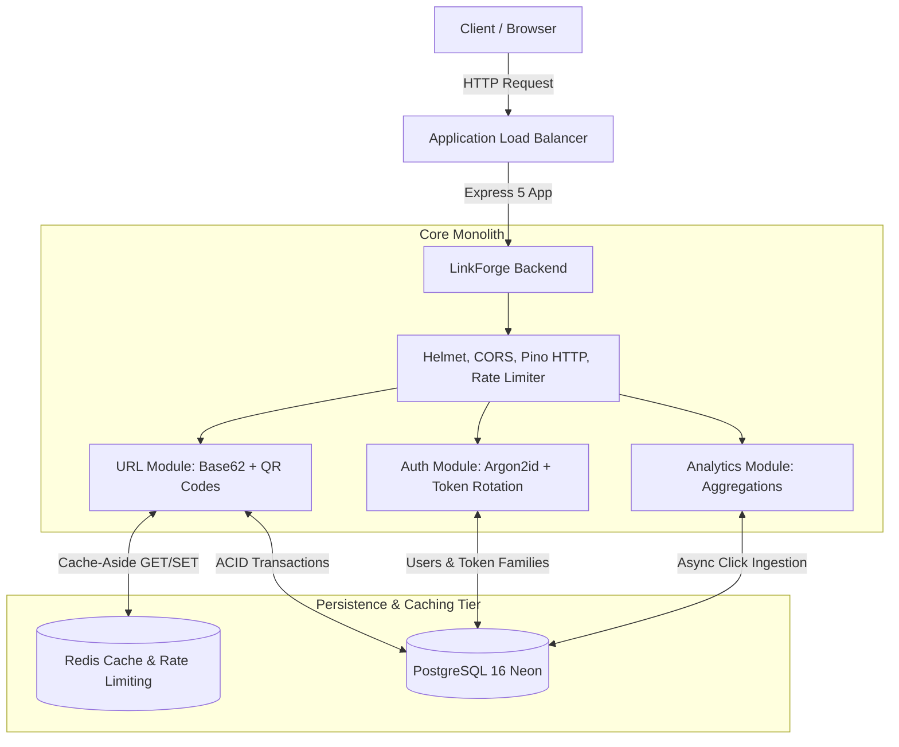

# 🚀 LinkForge — Production-Grade URL Shortener & Analytics Platform

[](https://github.com/Robert2101/LinkForge/actions)
[](LICENSE)
[](https://nodejs.org/)
[](https://www.postgresql.org/)
[](https://redis.io/)

LinkForge is an engineering-first, high-throughput URL shortening, redirection, and analytics platform designed to demonstrate modern distributed systems, web security, and backend scalability for ~20 LPA technical interviews.

---

## 🌟 Key Engineering Features

- **Modular Monolith Architecture:** Distinct, cleanly decoupled domain modules (`auth`, `urls`, `analytics`) with clear controller-service-repository layered boundaries.
- **Cryptographic Short-Code Generation:** Collision-resistant Base62 generation using CSPRNG bytes (`crypto.randomBytes`) with rejection sampling to eliminate modulo bias ($3.52 \times 10^{12}$ permutations for 7-char codes).
- **Custom Alias Race-Condition Resilience:** Defense-in-depth against TOCTOU race conditions via PostgreSQL engine-level `UNIQUE` index constraints with automatic code `23505` conflict resolution.
- **Advanced Authentication & Refresh Token Rotation:**
  - Password hashing with **Argon2id** (memory-hard, resistant to GPU/ASIC brute-forcing).
  - Short-lived JWT Access Tokens (15m) paired with database-tracked Refresh Tokens (7d) in secure HTTP-only cookies.
  - **Token Family Tracking & Breach Detection:** Automatic revocation of all family tokens if a previously revoked refresh token is replayed by an attacker.
- **High-Speed Redirection (Sub-5ms) with Redis Cache-Aside:**
  - Negative caching (`__NOT_FOUND__`) to prevent cache penetration attacks.
  - Graceful fallback to PostgreSQL if Redis is offline or unconfigured.
  - **HTTP 302 Found** semantics preserving analytics integrity and dynamic link control.
- **Asynchronous Click Analytics:**
  - Non-blocking click ingestion decoupled from HTTP redirects.
  - User-Agent categorization (Device, OS, Browser).
  - GDPR-compliant salted SHA-256 IP anonymization.
  - Aggregated timeseries, unique visitors, and categorical breakdowns.
- **Distributed Sliding-Window Rate Limiting:** Redis `ZSET` sliding window with automatic in-memory fallback.
- **QR Code Engine:** Instant PNG DataURL and vector SVG QR code generation for any shortened link.
- **Comprehensive Automated Tests:** 100% passing test suite across unit tests and end-to-end HTTP integration tests.
- **Docker & CI/CD:** Production multi-stage Dockerfile with non-root security, `docker-compose.yml`, and GitHub Actions workflow.

---

## 🏛 System Architecture



---

## 📁 Repository Structure

```
LinkForge/
├── .github/
│   └── workflows/
│       └── ci.yml             # GitHub Actions automated test & build pipeline
├── backend/
│   ├── src/
│   │   ├── config/            # Environment validation with Zod
│   │   ├── db/                # Drizzle schema, relations, and migration runner
│   │   ├── lib/               # DB connection, Redis client with fallback, Logger, Errors
│   │   ├── middleware/        # Authentication, Authorization, RateLimiter, Validation, ErrorHandler
│   │   ├── modules/
│   │   │   ├── auth/          # Registration, Login, Token Rotation, Me
│   │   │   ├── urls/          # Base62 generation, CRUD, Expiration, QR codes, Redirect
│   │   │   └── analytics/     # Async click recording, timeseries, categorical breakdowns
│   │   ├── routes/            # Main API v1 routing index
│   │   ├── app.js             # Express app setup and middleware pipeline
│   │   └── server.js          # HTTP network listener
│   ├── tests/
│   │   ├── unit/              # Base62 entropy, URL validation & SSRF guards
│   │   └── integration/       # Health, Auth rotation, URL CRUD, 302 Redirects, Analytics
│   ├── Dockerfile             # Multi-stage production container
│   ├── .dockerignore
│   └── package.json
├── docs/
│   ├── api/
│   │   └── openapi.yaml       # Complete OpenAPI 3.0 API specification
│   ├── architecture/
│   │   ├── system-overview.md # Component architecture
│   │   ├── data-flow.md       # Redirect and auth sequence diagrams
│   │   └── scaling.md         # Level 1 to Level 3 scaling roadmap
│   ├── decisions/             # Architecture Decision Records (ADR 001 - 008)
│   ├── notes/
│   │   └── repository-baseline.md
│   └── interview-guide.md     # 🎓 20 LPA System Design & Placement Interview Prep Manual
├── docker-compose.yml         # Local orchestration for PostgreSQL, Redis, Backend
└── README.md
```

---

## ⚡ Quick Start

### 1. Prerequisites
- Node.js 20+ (Node 24 recommended)
- PostgreSQL (or free Neon Serverless instance)
- Redis (Optional: LinkForge includes an in-memory fallback adapter for zero-friction local development)

### 2. Environment Configuration
Create `backend/.env` based on `backend/.env.example`:
```bash
cp backend/.env.example backend/.env
```
Ensure `DATABASE_URL` is set to your PostgreSQL connection string.

### 3. Run Database Migrations
```bash
cd backend
npm run db:migrate
```

### 4. Start Development Server
```bash
npm run dev
```
The server will start on `http://localhost:5001`.

### 5. Run Automated Tests
```bash
npm test
```

---

## 🔌 API Endpoints Summary

| Method | Endpoint | Description | Auth Required |
|---|---|---|---|
| `GET` | `/health` | Deep health check (DB latency + Redis status) | No |
| `GET` | `/:code` | Fast 302 Redirection + Async click recording | No |
| `POST` | `/api/v1/auth/register` | Register new user (Argon2id) | No |
| `POST` | `/api/v1/auth/login` | Login and issue token family + HTTP-only cookie | No |
| `POST` | `/api/v1/auth/refresh` | Rotate refresh token with reuse breach detection | Cookie/Body |
| `POST` | `/api/v1/auth/logout` | Revoke refresh session and clear cookie | No |
| `GET` | `/api/v1/auth/me` | Fetch authenticated user profile | Bearer Token |
| `POST` | `/api/v1/urls` | Create short URL (optional custom alias & expiry) | Optional |
| `GET` | `/api/v1/urls` | List user URLs with pagination | Bearer Token |
| `GET` | `/api/v1/urls/:id` | Get URL details | Optional |
| `PATCH` | `/api/v1/urls/:id` | Update destination or active status | Bearer Token |
| `DELETE` | `/api/v1/urls/:id` | Delete URL (invalidates Redis cache) | Bearer Token |
| `GET` | `/api/v1/urls/:id/qr` | Generate QR code (PNG DataURL or SVG) | No |
| `GET` | `/api/v1/analytics/:urlId/summary` | Click summary (24h, 7d, 30d, unique visitors) | Optional |
| `GET` | `/api/v1/analytics/:urlId/timeseries`| Daily click trends | Optional |
| `GET` | `/api/v1/analytics/:urlId/breakdown` | Device, OS, Browser, Referrer breakdown | Optional |
| `GET` | `/api/v1/analytics/overview` | User dashboard overview across all links | Bearer Token |

For the full specification, view [`docs/api/openapi.yaml`](docs/api/openapi.yaml).

---

## 🎓 20 LPA Placement Interview Manual

A dedicated interview preparation guide is available in [`docs/interview-guide.md`](docs/interview-guide.md). It answers:
- Why PostgreSQL + Drizzle was chosen over MongoDB and Prisma.
- Mathematical collision probability of Base62 generation and retry loops.
- Preventing TOCTOU race conditions on custom aliases.
- Preventing token replay attacks via Refresh Token Rotation and token families.
- Cache-Aside mitigation against Cache Stampede, Hot Keys, and Cache Penetration.
- How Redis sliding-window rate limiting prevents distributed abuse.
- Asynchronous click ingestion and GDPR-compliant IP anonymization.
- Scaling from Level 1 to Level 3 (10,000 req/sec) on AWS (ECS Fargate, ALB, SQS, CloudFront).