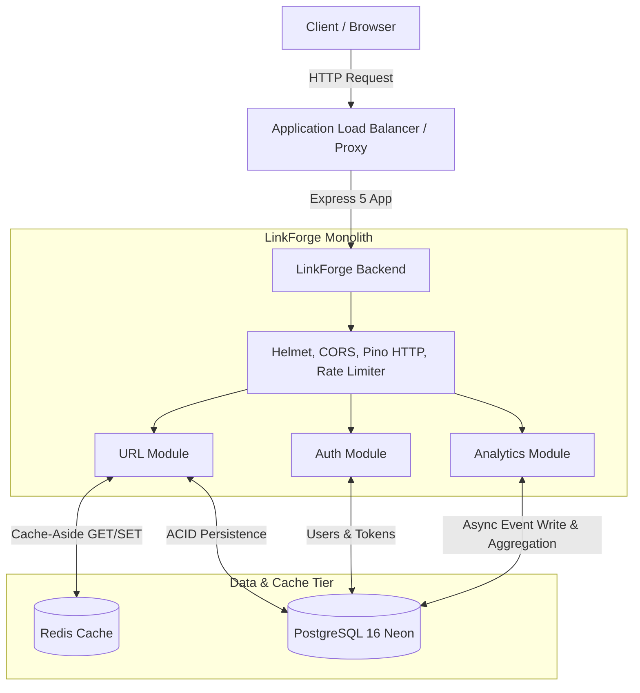

# LinkForge System Architecture Overview

## System Components
1. **API Gateway & Routing Layer:**
   - Express 5.x application handling HTTP parsing, security headers (Helmet), CORS, and structured logging (Pino).
2. **Authentication & Authorization Domain (`modules/auth`):**
   - Implements Argon2id password hashing.
   - Issues short-lived JWT access tokens and database-backed refresh token rotation families.
3. **URL Management & Resolution Domain (`modules/urls`):**
   - High-entropy Base62 cryptographically random short-code generation with collision retry loop.
   - Custom alias validation with atomic database conflict resolution.
   - QR code generation.
   - High-throughput HTTP 302 redirection.
4. **Analytics Domain (`modules/analytics`):**
   - Non-blocking click stream ingestion.
   - User-Agent categorization (Device, OS, Browser).
   - Salted SHA-256 IP anonymization.
   - Aggregated timeseries and categorical metrics.
5. **Caching & Resilience Layer:**
   - Redis cache-aside for sub-5ms URL resolution.
   - Distributed sliding-window rate limiting.
   - Graceful in-memory fallback if Redis is unavailable.
